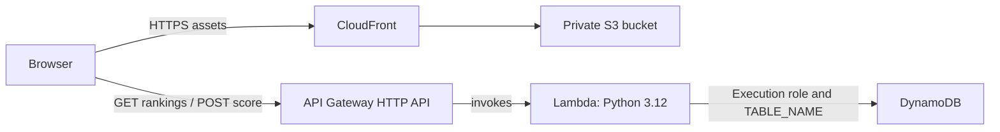

# QuizCloud

A trivia application built as a cloud engineering portfolio project. The frontend is served through Amazon CloudFront from a private S3 bucket. An API Gateway HTTP API, Python Lambda function, and DynamoDB table provide an optional public-beta leaderboard.

**[Live application](https://d17wyxi8cpi412.cloudfront.net)** · **[GitHub repository](https://github.com/Emmanuel2005-creator/QuizCloud)**

## Features

- Sports, Technology, Geography, and Movies: 80 questions with 10 unique questions selected per game.
- Randomized question order and answer choices, with a 20-second timer per question.
- Scoring, immediate feedback, results, answer review, and Play Again.
- Per-category personal bests stored in the browser using localStorage.
- Category rankings from the AWS API and optional public nickname/score submission.
- Responsive layouts and keyboard support. API failures leave the quiz and local bests usable.

The leaderboard is a beta: scores and browser-generated player IDs are not independently verified.

## Technologies and architecture

HTML, CSS, and vanilla JavaScript; Python 3.12 and boto3; Amazon S3, CloudFront, API Gateway, Lambda, and DynamoDB. Tests use Node.js, Playwright/Chrome, and Python unittest.



API Gateway invokes Lambda. Lambda uses its execution role for AWS permissions and `TABLE_NAME=QuizCloudLeaderBoard` to select the table. The table uses partition key `PlayerId` and sort key `category`. See [the architecture and resource inventory](docs/ARCHITECTURE.md).

## Local setup

Install Node.js 22 or later, then run from the project folder:

```sh
npm start
```

Open **http://127.0.0.1:8000**. Stop the preview with Ctrl+C. No package installation is needed to run the game. Alternatively, open `dist/index.html` directly; browser storage behavior for file URLs varies.

The core quiz works offline. Rankings require network access and an API-allowed origin. The live CloudFront origin is allowed; localhost may be blocked by CORS. Use the mocked suite for local API UI tests rather than disabling browser protections.

Personal bests are specific to the browser and origin. Refreshing discards an unfinished round; bests save when results open. A nickname and browser player ID are sent only when a player chooses Submit score. Avoid personal information in public nicknames.

## Tests

Syntax and game-unit checks require only Node.js:

```sh
npm run check
npm test
```

For UI tests, install the pinned development dependency with `npm ci`, install Google Chrome, and start `npm start` in another terminal:

```sh
npm run test:browser
```

This runs the original gameplay suite and nine leaderboard checks. Leaderboard requests, including submissions, are intercepted: no production scores are created. Generated screenshots stay in ignored `artifacts/`.

With Python 3.12, test the supplied Lambda source using SDK/table doubles:

```sh
python -m unittest discover -s tests -p "test_backend.py" -v
```

These backend tests require no installed boto3, credentials, or AWS access. To explicitly run read-only CloudFront/API integration checks:

```sh
npm run test:live
```

The live script blocks API writes, reads rankings in all categories, plays local-browser quiz rounds, and compares deployed assets with `dist/`. See [CHECKS.md](CHECKS.md) for actual results and test boundaries.

## Repository layout

```text
backend/   Supplied Lambda console source, provenance, and behavior notes
dist/      Complete static frontend; no build step
tests/     Game units, browser UI checks, backend units, and read-only live checks
docs/      Existing AWS architecture, deployment notes, and beta limitations
```

`dist/` is hand-authored application source and is intentionally tracked. `server.js` is a localhost preview server, not part of the AWS deployment. There are no production npm dependencies.

## Deployment and source backup

The frontend and leaderboard API are already deployed. GitHub merges do **not** update S3 or Lambda automatically. All seven live frontend files matched this branch during the final review; no frontend upload or invalidation was needed. [Deployment notes](docs/DEPLOYMENT.md) explain the existing release boundary and manual update procedure.

[backend/lambda_function.py](backend/lambda_function.py) preserves the Python supplied by the owner from the Lambda console. It was not rewritten or redeployed. Local AWS credentials were unavailable, so its identity with the deployed package was **not independently verified**. [Backend notes](backend/README.md) record provenance and the verification step still available to the owner.

## Known limitations

- Public scores and browser IDs can be forged. Frontend validation is not authentication or proof of quiz completion.
- The supplied Lambda uses one filtered DynamoDB Scan page; rankings can be incomplete as the table grows. Unexpected database errors propagate, while the frontend handles API failure.
- The actual IAM policies, table configuration, throttling, and bucket policy were not audited without AWS credentials. Do not infer least privilege from working requests.
- Live ranking reads and CORS preflight were verified; no production POST was sent. Live score acceptance/persistence still needs an explicitly approved test record.
- Automated browser coverage uses Chrome, not Safari, Firefox, or physical devices. No formal accessibility audit was performed.

[Security and reliability notes](docs/LEADERBOARD_BETA.md) distinguish implemented protections from unresolved backend work. No authentication, new AWS service, infrastructure tooling, or deployment pipeline was added. No open-source license has been selected.
