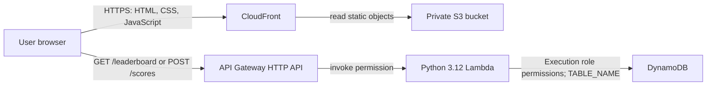

# Existing AWS architecture

The project owner supplied the resource names and configuration below. Public website/API behavior was checked on November 11, 2026. The AWS CLI had no usable credentials, so private resource settings and IAM policies were not independently inspected.

## Resource inventory

| Service | Existing resource | Purpose |
| --- | --- | --- |
| S3 | `quizcloud-emmanuel-2026` | Stores the contents of `dist/`; the owner reports a private bucket. |
| CloudFront | `d17wyxi8cpi412.cloudfront.net` | Delivers frontend assets over HTTPS and caches them. |
| API Gateway | `QuizCloudHTTPAPI` | Exposes HTTP routes, applies configured CORS behavior, and invokes Lambda. |
| API URL | `https://xdtbodt7p2.execute-api.us-east-1.amazonaws.com` | Public endpoint called by the browser. |
| Lambda | `QuizCloudLeaderboardAPI` | Validates requests and reads/conditionally updates scores. |
| DynamoDB | `QuizCloudLeaderBoard` | Stores per-player, per-category best scores. |
| Region | `us-east-1` | Supplied region for the backend and S3; CloudFront is a global service. |

## Frontend request flow

CloudFront serves `index.html`, the stylesheets, question bank, game engine, UI, and leaderboard connector from S3. The browser selects/shuffles questions, runs the timer, and calculates scores. Per-category personal bests remain in localStorage; they do not require AWS and do not synchronize across origins/devices.

CloudFront access to a private S3 origin should be restricted through origin access configuration and the bucket policy. Those actual settings were not inspected, so this review does not certify bucket privacy or a particular OAC/OAI configuration. [AWS private-origin guidance](https://docs.aws.amazon.com/AmazonCloudFront/latest/DeveloperGuide/private-content-restricting-access-to-s3.html) describes the boundary.

## Leaderboard request flow

1. Opening the board sends `GET /leaderboard?category=movies`, or another of the four categories, to API Gateway.
2. API Gateway invokes Lambda with an HTTP API event. The handler reads method/path from `requestContext.http` and category from `queryStringParameters`.
3. The supplied handler scans one DynamoDB page filtered by category, sorts available scores descending, and returns up to ten names/scores as JSON. The browser renders values as text.
4. A completed quiz can optionally send `POST /scores` with `{ playerId, name, category, score }` after the player enters a public nickname.
5. Lambda validates field types/lengths, category, and score range/step. It conditionally updates the item only if no score exists or the submitted score is higher.

The table's supplied partition key is `PlayerId` and sort key is `category`. The POST body calls the ID `playerId`; Lambda maps it to `PlayerId`. This provides one stored best per browser identity/category, not a verified human identity.

## Permissions and environment

API Gateway's permission to invoke Lambda is separate from Lambda's permission to use DynamoDB. Lambda's execution role supplies AWS credentials through the runtime's normal SDK chain. `TABLE_NAME=QuizCloudLeaderBoard` identifies a table but grants no permission itself.

The supplied source calls `dynamodb:Scan` and `dynamodb:UpdateItem`. A least-privilege review should restrict these actions to the intended table and review the role trust policy and invocation permission. Logging permissions are separate from application table access. Effective IAM policies could not be verified and were not changed. See [AWS Lambda permissions](https://docs.aws.amazon.com/lambda/latest/dg/lambda-permissions.html).

The API and site URLs are public configuration, not credentials. No AWS keys or private account identifiers belong in frontend code. The source backup is user-supplied and has not been independently compared with the live deployment package.
